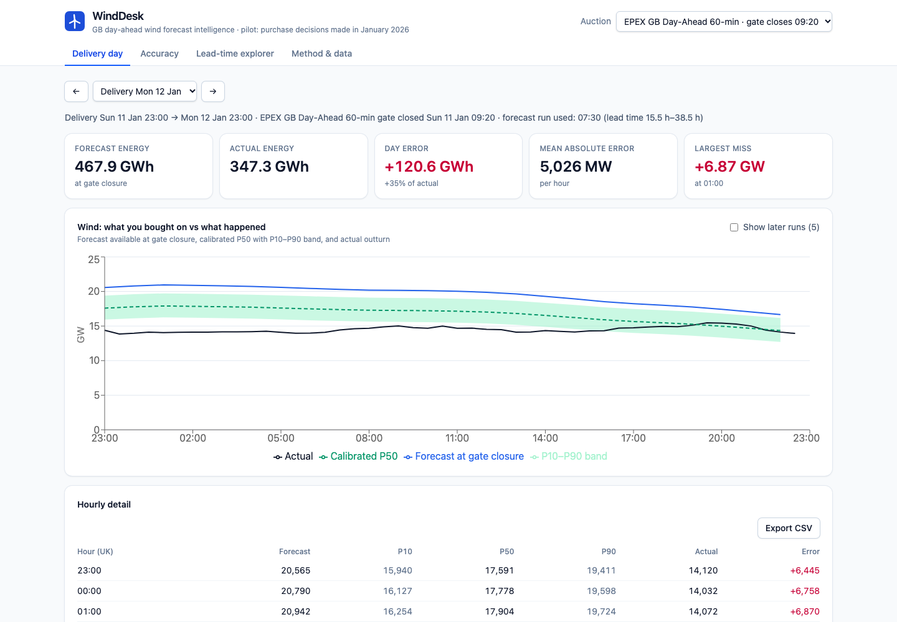

# WindDesk — day-ahead wind forecast intelligence

WindDesk shows a GB electricity supplier's day-ahead trading desk **which wind forecast it
actually had when the auction closed**, **how wrong that forecast turned out to be**, and **how
to adjust for the error**. It uses only Elexon BMRS national wind data and covers purchase
decisions made in January 2026.

**Live app:** [slnmeh.vercel.app](https://slnmeh.vercel.app) · **Video:** __VIDEO_URL__ · **Design doc:** [docs/design.md](docs/design.md)



## What it does

| View | Question it answers |
|---|---|
| **Delivery day** | What forecast did I have at gate closure, and how did the day turn out? Forecast vs actual, calibrated P50 with P10–P90 band, runs published after the decision, hourly table with CSV export. |
| **Accuracy** | How far can I trust the forecast, and how should I adjust? Raw vs calibrated metrics, error by lead time, hour of day, wind level and delivery day. |
| **Lead-time explorer** | How does accuracy change if the forecast must be at least *H* hours old (0–48 h; only forecast points up to 48 h ahead are used)? |
| **Method & data** | Definitions, assumptions, caveats and data completeness. |

An **auction selector** (EPEX 60-min 09:20, N2EX 09:50, EPEX 30-min 15:30, UK time on D−1)
sets the decision cutoff for every view.

## Key decisions

- **Decision time = auction gate closure.** The forecast shown for a delivery day is the latest
  WINDFOR run published at or before the selected auction's gate closure on the day before.
  Later runs are never used for the decision; a randomised test enforces this.
- **Delivery day = EFA day**, 23:00 UK on D−1 to 23:00 UK on D, as traded in the GB day-ahead
  auctions; DST-safe.
- **"Decisions made in January 2026"** means auctions held 1–31 January, so delivery days
  2 January – 1 February 2026.
- **Like-for-like comparison:** hourly forecast vs the mean of the two half-hourly actuals; WINDFOR
  rows that target hours before their own publish time are dropped; gaps are never filled.
- **Quantified error you can act on:** a linear calibration plus residual percentiles gives P10 /
  P50 / P90. Each day's values are fitted on the other days only (leave-one-day-out), so every
  calibrated number is out-of-sample.

## Headline findings (EPEX 60-min auction, 744 delivery hours)

| | |
|---|---|
| Mean absolute error of the forecast at gate closure | 2.04 GW (18% of mean wind) |
| Bias | +1.75 GW: too high in 85% of hours; +2.5 GW when 16–20 GW is forecast, +4.6 GW above 20 GW |
| Calibrated P50 error (out-of-sample) | 1.21 GW, 41% lower |
| P10–P90 band coverage | 78% (target 80%) |
| Error vs lead time (all runs) | 1.7 GW at 0–4 h → 2.0 GW across the day-ahead window → 2.4 GW at 44–48 h |
| Worst delivery days | 28 Jan, 12 Jan, 11 Jan (daily MAE 4.7–5.3 GW) |

## Quick start

Requires Docker.

```bash
docker compose up --build        # http://localhost:8000
```

### Develop

Requires [uv](https://docs.astral.sh/uv/) and Node 24.

```bash
make install
make dev-api      # API on http://localhost:8000 (hot reload)
make dev-web      # UI on http://localhost:5173 (proxies /api)
```

Or with Docker only: `docker compose --profile dev up api web` → http://localhost:5173.

| Command | What it does |
|---|---|
| `make test` | Backend (pytest) and frontend (Vitest) tests |
| `make lint` | ruff, mypy, ESLint, Prettier, TypeScript |
| `make ingest` | Re-fetch the pilot window from Elexon into `data/snapshot/` |
| `make openapi` | Re-export the API schema and regenerate frontend types |
| `make docker-run` | Build and run the production image |

## Repository layout

| Path | Contents |
|---|---|
| `backend/winddesk/domain/` | Pure domain logic: delivery-day rules, forecast selection, alignment, metrics, calibration |
| `backend/winddesk/ingest/` | Elexon BMRS client and snapshot CLI |
| `backend/winddesk/api/` | Pydantic response schemas and routes |
| `backend/winddesk/service.py` | Builds per-auction datasets at startup and assembles view models |
| `backend/winddesk/main.py` | App factory; serves the API and the built frontend |
| `backend/tests/` | Unit, API, recorded-HTTP ingest and regression tests |
| `data/snapshot/` | Elexon data for the pilot window plus a manifest with request parameters and checksums |
| `frontend/src/features/` | One folder per view |
| `frontend/src/api/` | Generated OpenAPI types, typed client, TanStack Query hooks |
| `frontend/src/lib/`, `frontend/src/components/` | Formatting (UK time), URL state, CSV, chart helpers; shared UI |
| `frontend/openapi.json` | API schema exported from the backend; source of the TypeScript types |
| `docs/design.md` | Product and technical design, assumptions and limitations |
| `Dockerfile`, `docker-compose.yml` | Production image (also what Vercel deploys), local run/dev |
| `Makefile`, `.github/workflows/ci.yml` | Common tasks; CI |

## Architecture

```
Elexon BMRS ──(make ingest)──▶ data/snapshot (CSV.gz + manifest)
                                    │ loaded once at startup
                                    ▼
             FastAPI ── domain layer (pure, tested) ──▶ /api/*  ──▶ React + TypeScript SPA
```

| Endpoint | Returns |
|---|---|
| `GET /api/meta` | Auctions, delivery days, pilot window, data completeness |
| `GET /api/delivery-day?date=&auction=` | Decision context, hourly forecast/band/actual, later runs, day summary |
| `GET /api/accuracy?auction=` | Raw vs calibrated metrics, calibration, breakdowns, series |
| `GET /api/lead-time?start=&end=&hours=` | Fixed-lead-time series and metrics |
| `GET /api/health` | Status and snapshot fetch time |

Interactive API docs are at `/docs` on any running instance.

## Engineering practices

- Domain logic is pure functions with no I/O, unit-tested in isolation, including clock-change days,
  a randomised no-look-ahead test, and a test that a day's own data can't influence its own
  calibrated values.
- A regression test pins the headline numbers on the committed snapshot to an independently
  written prototype.
- The frontend's TypeScript types are generated from the FastAPI OpenAPI schema; CI fails if they drift.
- CI runs lint, types and tests for both halves, the contract check, and a Docker build with a smoke test.
- One multi-stage, non-root Docker image runs locally, in CI and on Vercel.

## Deployment

Vercel (Container preset) builds the root `Dockerfile` on every push to `main` and serves it at
[slnmeh.vercel.app](https://slnmeh.vercel.app). Project settings: root directory = repository
root, environment variable `PORT=8000` (the port the image listens on). The same image runs
anywhere that accepts a container and sets `$PORT`.

## Assumptions and limitations

See [docs/design.md §7](docs/design.md#7-assumptions-and-limitations). In short: one winter month
of data (calibration is indicative), hourly evaluation for every auction, transmission-metered
wind only, and the curtailment explanation for the bias is a hypothesis.

## AI tools

This project was developed with **Claude Code** (Anthropic), used for research, design and
implementation. Scope and key design decisions were made by the author, and results are verified
by the automated tests described above.

## Data

Contains BMRS data © Elexon Limited copyright and database right 2026.
